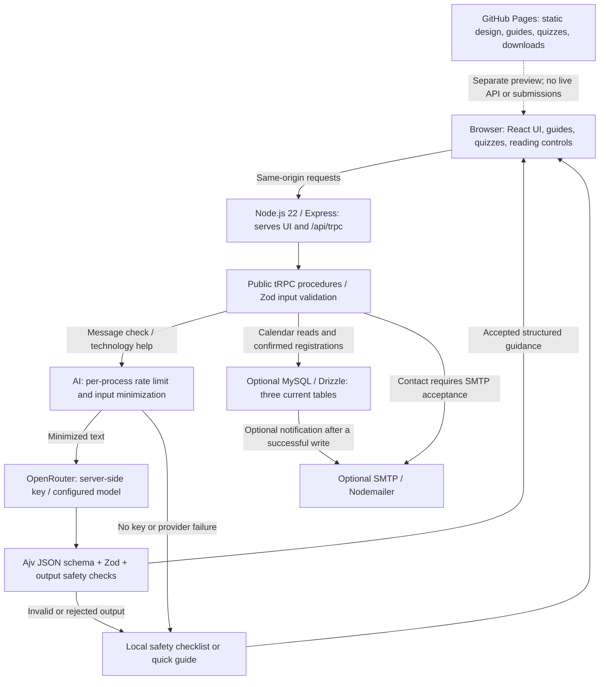

# Running Digital Guardians independently

[Back to README](../README.md) · [Security and privacy](SECURITY.md) · [Source repository](https://github.com/Philipmag/philipmag.github.io)

The full application runs on a standard Node.js host. It does not require Manus runtime providers, OAuth, an app ID, a platform account, or platform storage. OpenRouter is the only AI integration; MySQL and SMTP are optional services for specific community workflows. This is runtime independence, not a claim that Manus was never used during development.

**Hosting status:** the existing [www.digitalguards.ca](https://www.digitalguards.ca) site remains on Manus until a separately authorized publish or domain migration. The GitHub repository, Render blueprint, and Docker path do not establish that an independent backend is deployed. DNS and the public domain have not been switched by these instructions.

## Architecture



`src/` contains the React routes and shared UI. `server/app.ts` builds the Express API, `server/routers.ts` composes the public procedures, and `server/_core/index.ts` starts the HTTP server. `server/_core/llm.ts` implements the fixed OpenRouter transport; `server/scamAnalyzer.ts` owns the two AI contracts and fallback guidance. Database and mail adapters live in `server/db.ts` and `server/mail.ts`; the current schema is in `drizzle/schema.ts`.

Development mounts Vite behind the same Express app. Production serves the browser build from `dist/public` and the bundled Node entry point from `dist/index.js`. The API stays on the same origin as the UI. There are no accounts or authentication cookies; the retained `auth.me` and `auth.logout` procedures are compatibility no-ops, not a login system.

## Local setup

Install **Node.js 22** and use the repository's **pnpm 10.4.1** pin:

```bash
git clone --branch sync/digital-guardians-2026-11-25 https://github.com/Philipmag/philipmag.github.io.git
cd philipmag.github.io
corepack enable
corepack prepare pnpm@10.4.1 --activate
pnpm install --frozen-lockfile
cp config/env.example .env
pnpm dev
```

The server loads `.env` and listens on `0.0.0.0`, using `PORT=3000` by default. Visit `http://localhost:3000`. Keep `.env` private; `config/env.example` contains settings and placeholders, not credentials. In a managed hosting environment, use the host's secret settings rather than editing or exporting managed secrets into the repository.

For a production-style local run:

```bash
pnpm check
pnpm test
pnpm build
pnpm start
```

`GET /api/health` returns only `{"ok":true}`. It confirms that the process responds, not that OpenRouter, SMTP, or MySQL is ready. Unknown `/api/*` routes return JSON 404 rather than a misleading HTML success. Client-side guide routes receive the SPA shell on the full Node server.

## Optional configuration and honest service states

### OpenRouter

`OPENROUTER_API_KEY` is optional and server-only. Leave it unset to use the local no-provider mode. The app returns a **local precautionary safety checklist**, not an AI assessment, for a pasted message, and a **local quick guide**, not a personalized model answer, for technology help. A Node server is still needed for those fallback endpoints; this is not a service-worker or fully offline browser application.

Set `OPENROUTER_MODEL` to choose a compatible model; the default is `openrouter/free`. Requests go only to `https://openrouter.ai/api/v1/chat/completions`, ask for structured JSON, and require providers to support the requested parameters. Free routing, account quotas, latency, and model availability can change. A configured key therefore does not guarantee a live response or ongoing free availability.

The transport has an 18-second default total deadline and a 20-second ceiling, including response parsing and any configured retry. Technology help uses a shorter 12-second deadline. Public tool calls use one attempt; the transport's explicit retry setting is capped at two attempts within the same deadline. Missing credentials, timeouts, upstream failures, malformed JSON, schema failures, and rejected answers lead to labelled local guidance rather than invented AI success.

Never create `VITE_OPENROUTER_API_KEY` or put the key in a client bundle. The browser sends text to this app's server, which performs best-effort minimization before contacting OpenRouter. Review [Security](SECURITY.md) and [OpenRouter's privacy policy](https://openrouter.ai/privacy) before submitting anything sensitive.

### MySQL for calendar and training

`DATABASE_URL` enables durable calendar and training persistence. Guides and AI never require it. The current Drizzle schema has three tables:

- `events` stores workshop details, confirmed or TBD dates, session slots, availability, and capacity.
- `eventSignups` stores a registrant's contact details and optional notes for a specific event.
- `trainingRequests` stores personal-training requests, preferred dates, topics, and follow-up status.

Without a configured, reachable database, the calendar reports unavailable; it does not manufacture an empty schedule, a zero count, or a saved registration. Signup and training success require a confirmed database write. SMTP notification is optional **after** persistence, so a request can be saved successfully without an email notification. If a network failure makes write acknowledgement uncertain, the error asks the user to contact the program before resubmitting.

For a **new, disposable local database only**, set `DATABASE_URL`, then apply the current schema:

```bash
pnpm db:push
```

This script uses `drizzle-kit push`, not the historical migration chain. Historical SQL files retain earlier schema history, including an unused legacy `users` table; the current application does not use those accounts. Removal from the current schema does not mean historical user records have been deleted. Do not blindly run `db:push`, regenerate migrations, accept drop prompts, or replay historical migrations against a managed or populated database. Review the proposed changes, take a backup, and coordinate a non-destructive migration with its owner first.

Event capacity is checked before inserting a signup. Those operations are not transactionally locked, so concurrent registrations can exceed capacity. Add transactional locking or an equivalent atomic reservation design before a high-volume launch.

### SMTP for contact and optional notifications

Set `SMTP_HOST` and `SMTP_FROM` to enable mail. `SMTP_PORT` defaults to `587`; port `465` uses implicit TLS, while other ports require STARTTLS. If authentication is needed, supply both `SMTP_USER` and `SMTP_PASSWORD`. `SMTP_TO` defaults to `info@digitalguards.ca` and can be changed for a controlled development mailbox.

The contact endpoint does not persist messages. It returns success only after SMTP acceptance; without configuration or acceptance, it explicitly says that the message was not delivered or saved and offers direct email. SMTP acceptance is not proof of final inbox delivery. Training and signup notifications have different semantics: the database write is the source of success, and optional notification failure does not undo that write. Mail has a 12-second total bound and does not log submitted content or transport errors.

Do not submit real contact or registration forms during a recruiter demo unless you intend to send mail or create records. Use a sandbox mailbox and disposable database for integration testing.

## GitHub Pages: static preview only

```bash
pnpm build:gh-pages
```

This build compiles `VITE_STATIC_PREVIEW=1`. It is intended for the [philipmag.github.io](https://philipmag.github.io) repository's static preview: the design, learning guides, quizzes, preserved training downloads, and workshop-media presentation. Live AI and contact, registration, and training submissions are disabled with explicit availability messages and email/phone alternatives.

**Pages does not execute Express or host the Node AI endpoint.** An OpenRouter key in GitHub Pages assets would be public and is not a solution. This project does not support a `VITE_API_URL` bridge or a separately configured cross-origin API for Pages. Use `pnpm dev` locally or deploy the full Node app for live functions.

A successful static build is not evidence that the Pages site has been published. Publishing the preview and verifying its routes are separate release steps, and publishing must not be confused with migrating `www.digitalguards.ca`.

## Full Node deployment

### Render, Railway, or another Node host

The repository's [render.yaml](../render.yaml) is an **unprovisioned Render Blueprint**, not a provisioned service. Review it before creating a service and set secrets through the provider's private environment controls. Railway or another Node-capable host can use the same application commands:

```bash
# Build, with Node.js 22 available
corepack enable
corepack prepare pnpm@10.4.1 --activate
pnpm install --frozen-lockfile
pnpm build

# Start
pnpm start
```

The host should set `NODE_ENV=production` and supply its `PORT`. Set `APP_ORIGIN` to the exact public HTTPS origin, such as `https://your-node-app.example`, behind a reverse proxy. Enable `TRUST_PROXY=1` only when the deployment has a known, trusted one-hop proxy and direct access cannot bypass that trust boundary. Do not trust arbitrary forwarded headers. See [deployment security](SECURITY.md#deployment-configuration).

Start with a single app process because AI rate limits are held in process memory. Supply an optional OpenRouter key, database URL, and SMTP settings only for the workflows you want to enable. Verify health, labelled no-key fallback behavior, provider failures, and form error states before inviting public use. Database backups, HTTPS, monitoring, host lifecycle, quotas, and final DNS cutover remain deployment responsibilities. No availability SLA or future uptime is promised by the blueprint.

### Docker

The repository's Docker path is also **unprovisioned**. With the Dockerfile included and reviewed, build and run on your own Docker-capable machine or host:

```bash
docker build -t digital-guardians .
docker run --rm --name digital-guardians \
  --env-file .env \
  -e NODE_ENV=production -e PORT=3000 \
  -p 127.0.0.1:3000:3000 \
  digital-guardians
```

This example binds to localhost for a local demo. For public hosting, terminate HTTPS at a trusted reverse proxy, configure `APP_ORIGIN` and proxy trust accordingly, and manage the container lifecycle through your host. Pass secrets at runtime; do not bake `.env`, credentials, or a database into the image. MySQL is an optional independent service, not an automatically provisioned part of this command. Building an image does not deploy it or move the public domain.

## Testing and a recruiter walkthrough

```bash
pnpm check
pnpm test
pnpm build
pnpm build:gh-pages
```

The default suite uses mocked integrations and does not require credentials or make live provider calls. It covers the OpenRouter request contract, deadlines and error handling, malformed/unsafe output, redaction, the shared AI rate limit, no-credential local behavior, SMTP acceptance and failures, database failure semantics, API boundaries, and source-level design/reading-setting regressions. These checks are not a substitute for browser accessibility testing, load testing, or an independent security audit. No fixed test count or universal passing claim is implied; run the commands against the checkout you are reviewing.

Live credential and structured-output checks require explicit opt-in:

```bash
# Set OPENROUTER_API_KEY privately in the server environment first.
RUN_LIVE_OPENROUTER_TESTS=1 pnpm test:live
```

The flag is required even when a key exists. Keep this separate from ordinary CI; use synthetic text, a limited-budget key, and expect upstream outages or quota failures. These tests do not authorize live SMTP delivery or database writes.

A short walkthrough:

1. Run `pnpm dev` with no OpenRouter key, MySQL, or SMTP. Read the warm-paper home page and try text-size, contrast, and keyboard navigation.
2. Paste a synthetic message such as “Urgent: send gift cards to unlock your account.” Observe the **local** safety-check label, independent-verification advice, and absence of a claimed live assessment. Ask “How can I make text larger on my phone?” for a local quick guide.
3. Open a learning guide, answer its quiz, and inspect the original training downloads and manually controlled workshop slideshow. The generated café/library scenes are illustrations, not documented participants.
4. Visit Contact and Calendar to see honest unavailable states rather than fake delivery or saved-record confirmations. Avoid real submissions in a demo.
5. Optionally add a private server-side OpenRouter key and compare the AI-labelled structured response with the fallback. Explain that model-reported confidence is not calibrated accuracy and no answer proves a sender is genuine.
6. Build the Pages preview and explain why live actions are disabled there. Point to the Node architecture, test commands, and the unresolved capacity/shared-limiter tradeoffs rather than claiming impact statistics or completed deployment.

## Product and technical tradeoffs

The design prioritizes patient reading over decorative effects: paper and navy, DM Sans with a system fallback, a Georgia hero headline, comfortable body text, simple numbered rules, and direct state feedback. The crest, Peterborough identity, and program contact details are preserved. Reading settings are stored locally in the browser; quiz answers are in-memory rather than account-linked progress.

Typed tRPC contracts reduce client/server drift, while runtime Zod and Ajv validation handle untrusted inputs and model outputs. They do not establish semantic truth. Local guides keep the product useful when credentials or the provider are unavailable, but must remain visibly distinct from live AI. Optional MySQL avoids unnecessary setup for recruiters, while requiring real persistence for registration. SMTP acceptance avoids false contact success but does not prove inbox delivery.

The in-memory limiter is simple but resets on restart, can group users behind shared networks, and is not shared across multiple instances. Transactional event reservations, shared rate limiting, additional form-abuse protection, and deployment-specific observability remain work to address before scaling. No unsupported participation numbers, fraud-prevention statistics, or compliance certifications are used as evidence.

The redesign adapts [Unslop](https://github.com/heydamir/unslop) by Damir Sokolovsky ([@heydamir](https://x.com/heydamir)), under [CC BY 4.0](https://creativecommons.org/licenses/by/4.0/). The application's original [MIT license](../LICENSE) remains intact. Generated scenes are labelled illustrative; original workshop media and training documents were supplied by the program owner and are not relicensed by this method credit.

**Digital Guardians, Peterborough, Ontario** · [info@digitalguards.ca](mailto:info@digitalguards.ca) · [+1 (705) 772-5140](tel:+17057725140)
